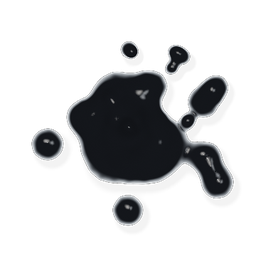
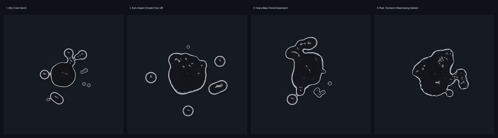
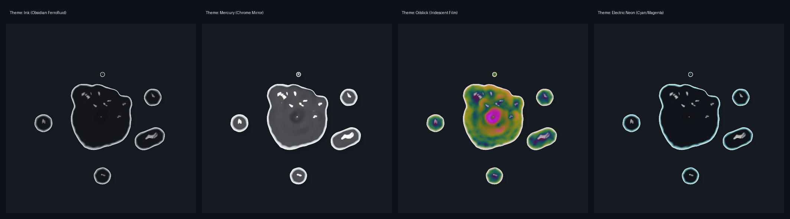
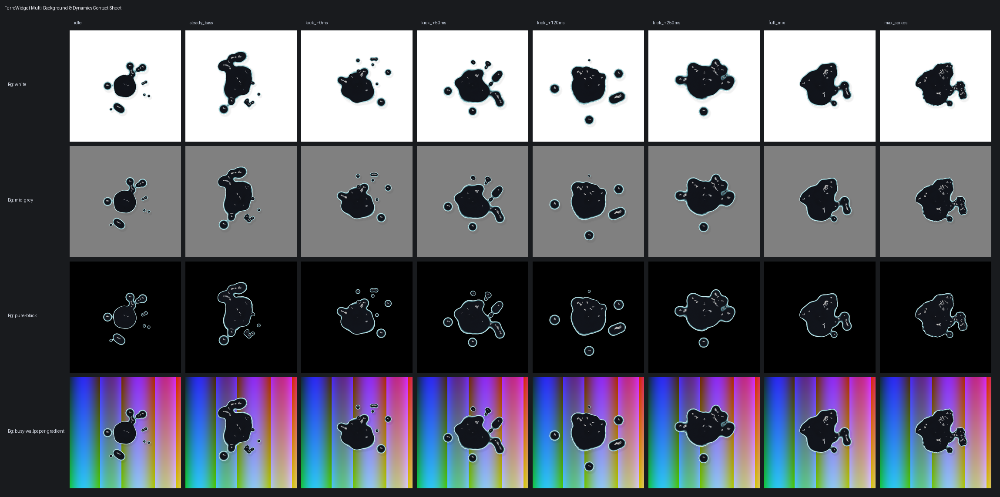
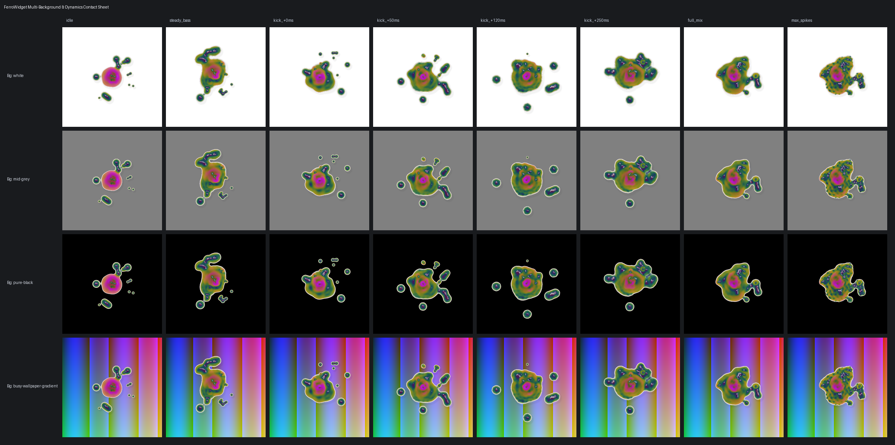
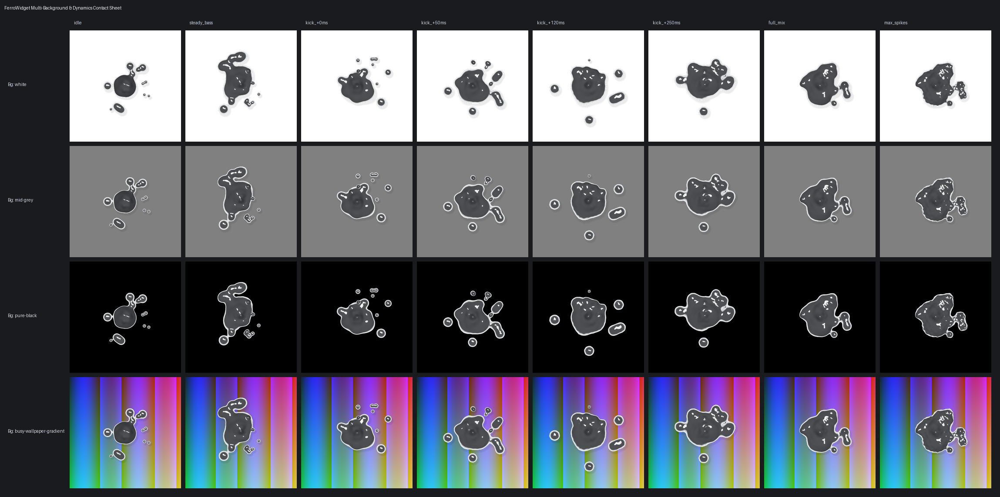

<div dir="rtl">

<p align="center" dir="ltr">
  <a href="https://github.com/sarkarpour/venom-dans">
    
  </a>
</p>

# فرومگنت (FerroWidget) 🧪✨
### ویجت رومیزی فوق‌واقع‌گرایانه فروسیال (مایع مغناطیسی) رقصنده با صدای سیستم

<div align="center" dir="ltr">

[](https://github.com/sarkarpour/venom-dans/releases)
[](#releases)
[](https://github.com/sarkarpour/venom-dans)
[](https://github.com/astral-sh/ruff)
[](LICENSE)
[](#releases)
[](https://www.python.org/downloads/)

---

### 🌐 زبان‌ها / Languages
[**English**](README.md) • [**فارسی (Persian)**](README.fa.md)

---

</div>

**فرومگنت (FerroWidget)** یک ویجت رومیزی سبک، سریع و بسیار چشم‌نواز است که یک قطره فروسیال مشکی صیقلی (شبیه به ونوم/مایع مغناطیسی واقعی) را مستقیماً روی صفحه مانیتور شما به نمایش می‌گذارد. پس‌زمینه این برنامه **۱۰۰٪ شفاف** است (بدون کادر، بدون پس‌زمینه مربعی و بدون قاب پنجره) و به طور زنده و بلادرنگ با هر صدایی که در سیستم در حال پخش است (اسپاتیفای، یوتیوب، فیلم، بازی و غیره) با کمترین تاخیر ممکن ($<60\text{ ms}$) می‌رقصد.

این نرم‌افزار با شبیه‌سازی فیزیک واقعی هیدرودینامیک مغناطیسی، پدیده‌های شگفت‌انگیزی مانند کشیدگی مایع، جدا شدن قطرات سرگردان (Pinch-off)، ادغام دوباره آن‌ها با بدنه اصلی و رویش خارهای شش‌ضلعی روزنزویگ (Rosensweig Spikes) را در فرکانس‌های بم و بیس آهنگ بازآفرینی می‌کند.

---

<a id="releases"></a>
## 📥 دانلود مستقیم و ریلیزها (Releases)

> [!TIP]
> **نسخه v0.1.0 با بسته‌های آماده و تست‌شده منتشر شد!** با کلیک روی هر یک از دکمه‌های **دانلود مستقیم** زیر، فایل نصبی مستقیماً در مرورگر شما دانلود می‌شود؛ همچنین می‌توانید به صفحه [ریلیزهای گیت‌هاب](https://github.com/sarkarpour/venom-dans/releases) مراجعه فرمایید.

<div dir="ltr">

| پلتفرم / سیستم‌عامل | پسوند | نسخه | حجم | ⚡ لینک دانلود مستقیم (یک‌کلیک) | دستور نصب سریع |
|:---|:---:|:---:|:---:|:---:|:---|
| **🐧 لینوکس (دبیان / اوبونتو / مینت)** | `.deb` | `v0.1.0` | `~127 KB` | [**⬇️ دانلود مستقیم دبیان (.deb)**](https://raw.githubusercontent.com/sarkarpour/venom-dans/main/dist/ferrowidget_0.1.0_all.deb) | `sudo dpkg -i ferrowidget_0.1.0_all.deb` |
| **🐧 لینوکس (تمام توزیع‌ها - پرتابل)** | `.tar.gz` | `v0.1.0` | `~91 KB` | [**⬇️ دانلود پکیج لینوکس (.tar.gz)**](https://raw.githubusercontent.com/sarkarpour/venom-dans/main/dist/ferrowidget-linux.tar.gz) | `tar -xzf ferrowidget-linux.tar.gz && bash install_linux.sh` |
| **🪟 ویندوز (۱۰ و ۱۱ - پرتابل)** | `.zip` | `v0.1.0` | `~160 KB` | [**⬇️ دانلود مستقیم پکیج ویندوز (.zip)**](https://raw.githubusercontent.com/sarkarpour/venom-dans/main/dist/ferrowidget-windows.zip) | استخراج و کلیک روی `install_windows.bat` |
| **🤖 اندروید (PWA تحت وب و آفلاین)** | `.zip` | `v0.1.0` | `~204 KB` | [**⬇️ دانلود مستقیم نسخه اندروید (.zip)**](https://raw.githubusercontent.com/sarkarpour/venom-dans/main/dist/ferrowidget-android.zip) | باز کردن `index.html` ← "Add to Home screen" |
| **🐍 بسته پایتون (Wheel عمومی)** | `.whl` | `v0.1.0` | `~49 KB` | [**⬇️ دانلود مستقیم پکیج پایتون (.whl)**](https://raw.githubusercontent.com/sarkarpour/venom-dans/main/dist/ferrowidget-0.1.0-py3-none-any.whl) | `pip install ferrowidget-0.1.0-py3-none-any.whl` |

</div>

### 🔐 کدهای اعتبارسنجی و هش بسته (SHA-256)
جهت اطمینان از سلامت فایل‌های دانلودی:
```text
54c547a0db8247c68103706f1d60f8956b6bc082b76075cc712196f7a827aa49  ferrowidget_0.1.0_all.deb
740cb74f02fb9058edbfa4984199173d396ce5174b90e10c07428b1a4cba6327  ferrowidget-linux.tar.gz
ecf93d0f4d802bd8425ef05ae8ef2490f1107e6b01f713d3d7d668927770e611  ferrowidget-windows.zip
d1b940d6e6356c6c732cd79db497da54e69582ea5625bdc9afc2f8f66a28a54f  ferrowidget-android.zip
754f383c73b5429d165e543f7768bb10488b90dcad25acd4fa4e77d935294278  ferrowidget-0.1.0-py3-none-any.whl
```

---

## 🎬 پیش‌نمایش‌های تصویری و اسکرین‌شات‌ها

### ۱. شبیه‌سازی فروسیال روی پس‌زمینه‌های گوناگون دسکتاپ
*قطره فروسیال سیاه براق روی پس‌زمینه‌های سفید، خاکستری، مشکی خالص (همراه با نورپردازی بازتابی لبه‌ها جهت وضوح کامل روی والپیپرهای تاریک) و والپیپرهای رنگی:*


### ۲. پویایی واکنش صوتی و مراحل فیزیک فروسیال
*از چرخش آرام در زمان سکوت تا ضربه سنگین درام و کیک، پرتاب قطرات و تشکیل خارهای شش‌ضلعی روزنزویگ:*



### ۳. گالری پوسته‌های بصری (Themes)
*تغییر زنده و بلادرنگ میان ۴ استایل استودیویی HDR:*



| پوسته: نئون برقی (Neon) | پوسته: روغنی رنگین‌کمانی (Oilslick) | پوسته: جیوه مایع (Mercury) |
|:---:|:---:|:---:|
|  |  |  |

---

## ⚡ ویژگی‌های برجسته

- **شفافیت کامل و شناور بودن روی دسکتاپ**: به لطف رندرینگ شیدر ModernGL/OpenGL Core 3.3 و ماسک‌های کلیک X11/XShape، ویجت هیچ حاشیه یا کادر مربعی ندارد و برش نمی‌خورد؛ قطرات کاملاً روان در فضای دسکتاپ حرکت می‌کنند و کلیک‌های ماوس مستقیماً از روی آن رد می‌شوند.
- **شنود مستقیم صدای سیستم**: صدای خروجی سیستم را به صورت مستقیم از طریق مانیتور PipeWire یا PulseAudio در لینوکس، WASAPI در ویندوز یا میکروفون در اندروید بدون نیاز به کابل مجازی دریافت می‌کند.
- **شبیه‌سازی فیزیک ۶۴ قطره و ۱۹ آهنربای الکتریکی**:
  - ۶ هسته مرکزی تشکیل‌دهنده توده مادر
  - ۲۲ قطعه اقماری با قابلیت پرتاب و چسبیدن مجدد
  - ۳۶ ریزقطره شناور
  - شبیه‌سازی ادغام سطحی، کشش سطحی و پرتاب بر اثر ضربات درام و کیک (Kick/Bass)
- **شیدرهای استودیویی HDR**:
  - فرمول‌بندی سطح منیسک ۲.۵ بعدی با ریزموج‌های مویینگی
  - منابع نور سافت‌باکس استودیویی و نقاط درخشان براق (Specular Glints)
  - نور بازتابی لبه‌ها (Floor Bounce) جهت تفکیک دقیق روی زمینه‌های کاملاً سیاه
  - سنتر خارهای روزنزویگ با پاسخ فوری به فرکانس‌های ساب‌بیس
- **۴ پوسته زیبا**:
  - `ink`: رنگ سیاه کریستالی عمیق، هایلایت‌های سفید درخشان و حاشیه خاکستری ملایم.
  - `mercury`: فلز جیوه مایع با بازتاب‌های آینه‌ای فوق‌العاده شفاف.
  - `oilslick`: پایه تیره با رنگین‌کمان لایه‌نازک نوری (شبیه لکه بنزین روی آب).
  - `neon`: بدنه تیره با حاشیه‌های درخشان فیروزه‌ای و سرخابی.
- **پشتیبانی کامل از لینوکس، ویندوز و اندروید**.

---

## 📦 راهنمای نصب در سه سیستم‌عامل

### ۱. راهنمای نصب روی لینوکس (Linux)

#### روش الف: بسته دبیان / اوبونتو (`.deb`) — روش پیشنهادی و مستقیم
فایل [`ferrowidget_0.1.0_all.deb`](https://raw.githubusercontent.com/sarkarpour/venom-dans/main/dist/ferrowidget_0.1.0_all.deb) را دانلود کرده و اجرا کنید:
```bash
sudo dpkg -i ferrowidget_0.1.0_all.deb
sudo apt install -f   # در صورت نیاز به دانلود پیش‌نیازهای سیستمی
```

#### روش ب: اسکریپت نصب یک‌کلیکه برای تمام توزیع‌ها (Arch, Fedora, openSUSE)
```bash
curl -sSL https://raw.githubusercontent.com/sarkarpour/venom-dans/main/packaging/linux/install_linux.sh | bash
```
یا پکیج پرتابل [`ferrowidget-linux.tar.gz`](https://raw.githubusercontent.com/sarkarpour/venom-dans/main/dist/ferrowidget-linux.tar.gz) را دانلود و استخراج کرده و اجرا کنید:
```bash
tar -xzf ferrowidget-linux.tar.gz
bash install_linux.sh
```

#### روش ج: اجرای دستی از سورس کد
```bash
git clone https://github.com/sarkarpour/venom-dans.git
cd venom-dans
python3 -m venv .venv
source .venv/bin/activate
pip install -e .
ferrowidget run
```

---

### ۲. راهنمای نصب روی ویندوز (Windows)

۱. مطمئن شوید [پایتون ۳.۱۰ یا بالاتر](https://www.python.org/downloads/) نصب است و حتماً گزینه **"Add python.exe to PATH"** را فعال کرده‌اید.  
۲. بسته فشرده [`ferrowidget-windows.zip`](https://raw.githubusercontent.com/sarkarpour/venom-dans/main/dist/ferrowidget-windows.zip) را مستقیماً دانلود و استخراج کنید.  
۳. روی فایل `install_windows.bat` دوبار کلیک کنید.  
۴. برنامه تمام پکیج‌ها را به صورت خودکار نصب کرده و میانبر **FerroWidget** را روی دسکتاپ می‌گذارد و ویجت در پس‌زمینه اجرا می‌شود.

*اگر قصد ساخت فایل تک‌فایلی مستقل (`.exe`) بدون نیاز به پایتون را دارید:*
```cmd
pip install pyinstaller
pyinstaller packaging\windows\ferrowidget.spec
```
فایل اجرایی در پوشه `dist\ferrowidget.exe` ایجاد خواهد شد.

---

### ۳. راهنمای نصب روی اندروید (Android)

ویجت برای گوشی‌های اندرویدی با موتور گرافیکی WebGL 2.0 پورت شده است:

#### روش الف: وب‌اپلیکیشن پیش‌رونده (PWA) — پیشنهاد شده
۱. فایل [`ferrowidget-android.zip`](https://raw.githubusercontent.com/sarkarpour/venom-dans/main/dist/ferrowidget-android.zip) را دانلود و استخراج کنید یا مستقیماً فایل [`packaging/android/web_visualizer/index.html`](packaging/android/web_visualizer/index.html) را در مرورگر کروم گوشی باز کنید.  
۲. روی منوی سه نقطه کروم **(⋮)** ضربه بزنید و گزینه **«Add to Home screen»** یا **«نصب برنامه (Install app)»** را انتخاب کنید.  
۳. برنامه به شکل یک اپلیکیشن مستقل با آیکون اختصاصی روی صفحه گوشی نصب می‌شود و کاملاً آفلاین کار می‌کند!  
۴. با زدن دکمه **🎤 Mic** اجازه دسترسی میکروفون را بدهید تا قطره فروسیال با صدای موزیک یا محیط واکنش دهد.

#### روش ب: ساخت فایل خروجی APK برای نصب مستقیم
با استفاده از فریمورک Capacitor یا ابزار رایگان PWABuilder می‌توانید نسخه وب را در چند دقیقه به یک فایل `.apk` قابل نصب تبدیل کنید:
```bash
npm install @capacitor/core @capacitor/cli @capacitor/android
npx cap init FerroWidget com.ferrowidget.app --web-dir packaging/android/web_visualizer
npx cap add android
npx cap build android
```

#### روش ج: اجرای نسخه کامل لینوکسی با Termux و Termux:X11
```bash
pkg install git curl
curl -sSL https://raw.githubusercontent.com/sarkarpour/venom-dans/main/packaging/android/termux_install.sh | bash
```

---

## 🚀 نحوه استفاده و کنترل برنامه

### اجرای ویجت
```bash
# اجرای استاندارد با صدای خروجی سیستم
ferrowidget run

# اجرای آزمایشی با ترک‌های شبیه‌سازی‌شده صوتی
ferrowidget run --synthetic full_mix

# تعیین اندازه اولیه و موقعیت گوشه صفحه
ferrowidget run --size 450 --anchor bottom-right
```

### حالت‌های عملکرد
برنامه در دو حالت کار می‌کند:
۱. **حالت قفل (LOCKED Mode - پیش‌فرض)**:
   - ویجت کاملاً شفاف است و ماوس از روی آن رد می‌شود (Click-Through)؛ بنابراین مانع کار کردن شما با سایر برنامه‌ها و پنجره‌ها نمی‌شود.
۲. **حالت ویرایش (EDIT Mode)**:
   - **کلیک چپ و کشیدن (Drag)**: جابه‌جا کردن ویجت روی مانیتورها.
   - **اسکرول ماوس (Wheel)**: تغییر اندازه ویجت به صورت روان بین ۱۲۸ تا ۱۲۰۰ پیکسل.
   - **دوبار کلیک یا کلید Esc**: ذخیره موقعیت و اندازه در فایل تنظیمات و قفل مجدد.

---

### کنترل از طریق خط فرمان (`ferrowidget ctl`)
می‌توانید برنامه در حال اجرا را بدون نیاز به ریستارت از ترمینال کنترل کنید:

```bash
# تغییر وضعیت به حالت ویرایش (جابجایی / تغییر سایز)
ferrowidget ctl edit toggle

# تغییر لحظه‌ای پوسته بصری
ferrowidget ctl theme oilslick
ferrowidget ctl theme neon
ferrowidget ctl theme mercury
ferrowidget ctl theme ink

# تغییر حالت فیزیک و رقص مایع
ferrowidget ctl preset calm        # آرام و روان
ferrowidget ctl preset club        # واکنش پرهیجان به بیس و درام
ferrowidget ctl preset cinematic   # حرکات سینمایی با خارهای کشیده

# تغییر اندازه و مختصات روی مانیتور
ferrowidget ctl size 500
ferrowidget ctl move 1200 650

# استعلام وضعیت لحظه‌ای و فریم‌ریت (FPS)
ferrowidget ctl status
```

---

### منوی کنار ساعت (System Tray)
یک آیکون قطره براق در کنار ساعت سیستم شما ظاهر می‌شود:
- **Edit Position & Size**: فعال‌سازی حالت جابه‌جایی و تغییر اندازه.
- **Theme**: انتخاب سریع میان ۴ پوسته.
- **Physics Preset**: انتخاب الگوی فیزیک (`Calm`, `Club`, `Cinematic`).
- **Size**: انتخاب اندازه‌های از پیش تعریف‌شده (۲۵۶، ۳۶۰، ۴۲۰، ۶۰۰، ۸۰۰ پیکسل).
- **Reload Config**: اعمال مجدد تغییرات فایل کانفیگ بدون بستن برنامه.
- **Quit**: بستن کامل برنامه.

---

## ⚙️ راهنمای فایل تنظیمات (`config.toml`)

محل ذخیره فایل تنظیمات:
- **لینوکس**: `~/.config/ferrowidget/config.toml`
- **ویندوز**: `%LOCALAPPDATA%\FerroWidget\config.toml`

```toml
[window]
x = -1                  # مختصات افقی (-1 یعنی محاسبه خودکار بر اساس گوشه صفحه)
y = -1                  # مختصات عمودی (-1 یعنی محاسبه خودکار بر اساس گوشه صفحه)
size = 420              # اندازه مربع به پیکسل (128 تا 1200)
anchor = "bottom-right" # گوشه پیش‌فرض: "top-left", "top-right", "bottom-left", "bottom-right", "center"
margin = 24             # فاصله از حاشیه مانیتور (پیکسل)
layer = "top"           # لایه نمایش: "top" (همیشه رو), "normal", "bottom" (زیر پنجره‌ها)
locked = true           # آیا کلیک ماوس از روی آن رد شود؟ (true یعنی بله)

[audio]
source = "auto"         # منبع صوتی: "auto" یا نام اختصاصی کارت صدا
sensitivity = 1.0       # ضریب حساسیت به صدا (0.1 تا 10.0)
visual_delay_ms = 0     # تاخیر جبرانی تصویر با صدا (میلی‌ثانیه)
agc = true              # تنظیم خودکار بلندی صدا (AGC)

[fluid]
preset = "club"         # حالت فیزیک: "calm" (آرام), "club" (باشگاهی/بیس‌دار), "cinematic" (سینمایی)
droplets = 64           # تعداد کل قطرات شبیه‌سازی‌شده
viscosity = 1.0         # ضریب گرانروی و لزجت مایع
magnet_gain = 1.0       # قدرت کشش آهنرباها
kick_impulse = 1.0      # شدت انفجار قطرات با ضربه کیک
spike_amount = 1.0      # ضریب بلندی خارهای شش‌ضلعی روزنزویگ
idle_breathing = true   # تنفس ارگانیک آرام در زمان سکوت

[look]
theme = "ink"           # پوسته: "ink", "mercury", "oilslick", "neon"
rim = 0.65              # شدت نور حاشیه بیرونی قطره
glints = 1.0            # درخشش نقاط براق آینه‌ای
shadow = 0.22           # تیرگی سایه زیر قطره
iridescence = 0.0       # ضریب رنگین‌کمانی روغن

[perf]
fps_cap = 60            # سقف فریم‌ریت رندرینگ
idle_fps = 60           # فریم‌ریت در زمان بی‌صدایی
render_scale = 1.0      # ضریب رزولوشن داخلی FBO
mode = "heightfield"    # موتور رندر: "heightfield" (سریع) یا "raymarch" (سه‌بعدی)
```

---

## 🧪 دستورات تست و توسعه

```bash
# تست سلامت سیستمی
ferrowidget doctor

# خروجی گرفتن از تمام فریم‌ها و کانتکت‌شیت
ferrowidget dump-frame --synthetic kick120 --contact-sheet --out dumped_frames

# اجرای کل آزمون‌های خودکار
pytest
```

---

## 📄 لایسنس

این پروژه تحت لایسنس [MIT](LICENSE) منتشر شده است و استفاده از آن آزاد و رایگان می‌باشد.

</div>
