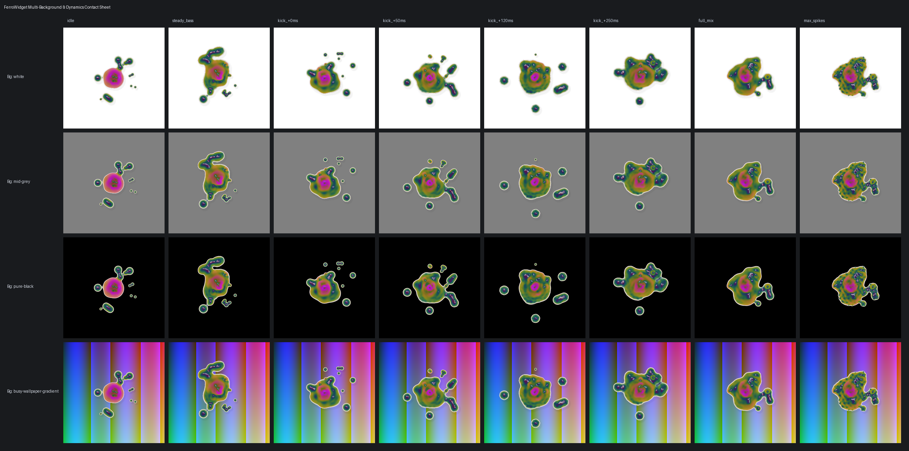
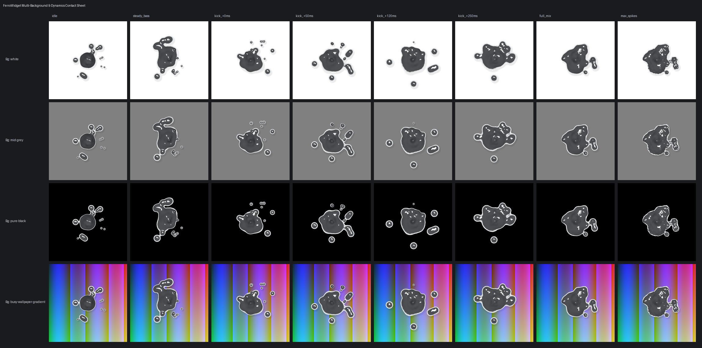

# FerroWidget 🧪✨

<div align="center">

[]()
[]()
[]()
[]()
[]()

**A photorealistic, glossy ferrofluid desktop widget dancing in real-time to your system audio.**  
*Floating directly on your desktop with true per-pixel transparency (no window border, no background box).*

---

### 🌐 Language / زبان
[**English**](README.md) • [**فارسی (Persian)**](README.fa.md)

---

</div>

## 🎬 Visual Previews

### Obsidian Liquid Across Multiple Backgrounds
*Obsidian ferrofluid reacting across white, grey, pure black (with cyclorama floor bounce illumination), and colorful desktop wallpapers:*


### Visual Themes Gallery
| Theme: Electric Neon | Theme: Rainbow Oilslick | Theme: Liquid Mercury |
|:---:|:---:|:---:|
|  |  |  |

---

## ⚡ Highlights

- **Zero-Border Floating Desktop Liquid**: True per-pixel alpha OpenGL transparency. No square box, no dark rectangle, no clipping at edges. Droplets float and splash freely over your wallpaper and apps.
- **Ultra-Low Latency Audio Capture**: Captures whatever is playing on your computer (Spotify, YouTube, VLC, Games) via PipeWire / PulseAudio monitor sink, Windows WASAPI, or microphone with $< 60\text{ ms}$ total latency.
- **Physical Ferrofluid Simulation**: 64 metaball droplets and 19 electromagnets governed by 240 Hz underdamped spring ODEs, pairwise cohesion, surface tension, tear-off pinching, and re-attachment coalescence.
- **Studio HDR Shading**:
  - Analytic signed-distance anti-aliased silhouette.
  - 2.5D meniscus height-field with micro-capillary ripples.
  - Studio softboxes, razor-sharp pinpoint specular glints, and cyclorama floor bounce for black wallpapers.
  - Rosensweig hexagonal spike synthesis responding to bass and sub-bass transients.
- **4 Distinct Themes**:
  - `ink`: Deep obsidian black (`F0 = 0.065`), crisp white glints, cool-grey rim.
  - `mercury`: Liquid silver chrome (`F0 = 0.92`), brilliant mirror reflections.
  - `oilslick`: Obsidian base with dynamic thin-film rainbow iridescence.
  - `neon`: Obsidian black with electric cyan/magenta glow rim.
- **Cross-Platform**: Installable on **Linux**, **Windows**, and **Android**.

---

## 📦 Download & Installation

Ready-to-install packages are located in the [`dist/`](dist/) folder:

| Platform | Package File | Quick Install Command |
|:---|:---|:---|
| **🐧 Linux (Debian/Ubuntu)** | [`dist/ferrowidget_0.1.0_all.deb`](dist/ferrowidget_0.1.0_all.deb) | `sudo dpkg -i dist/ferrowidget_0.1.0_all.deb` |
| **🐧 Linux (Any Distro)** | [`packaging/linux/install_linux.sh`](packaging/linux/install_linux.sh) | `bash packaging/linux/install_linux.sh` |
| **🪟 Windows (10 / 11)** | [`dist/ferrowidget-windows.zip`](dist/ferrowidget-windows.zip) | Extract and double-click `install_windows.bat` |
| **🤖 Android (PWA / APK)** | [`dist/ferrowidget-android.zip`](dist/ferrowidget-android.zip) | Open `web_visualizer/index.html` → "Add to Home screen" |

---

### 1. Linux Setup

#### Method A: Debian / Ubuntu Package (`.deb`)
```bash
sudo dpkg -i dist/ferrowidget_0.1.0_all.deb
sudo apt install -f   # Installs dependencies if needed
```

#### Method B: One-Command Distro-Agnostic Installer
```bash
bash packaging/linux/install_linux.sh
```

#### Method C: Developer Virtual Environment
```bash
git clone https://github.com/asa/ferrowidget.git
cd ferrowidget
python3 -m venv .venv
source .venv/bin/activate
pip install -e .
```

---

### 2. Windows Setup

1. Install [Python 3.10+](https://www.python.org/downloads/) (check **"Add python.exe to PATH"**).
2. Download and unzip [`dist/ferrowidget-windows.zip`](dist/ferrowidget-windows.zip) or clone the repository.
3. Double-click `install_windows.bat`.
4. A desktop shortcut named **FerroWidget** will be created, and the widget will launch automatically in the background.

*To build a single standalone `.exe` without Python installed on the target machine:*
```cmd
pip install pyinstaller
pyinstaller packaging\windows\ferrowidget.spec
```
The resulting executable is generated in `dist\ferrowidget.exe`.

---

### 3. Android Setup

FerroWidget on Android runs via a hardware-accelerated WebGL 2.0 PWA with live microphone reactivity:

#### Method A: Progressive Web App (PWA) — Recommended
1. Open [`packaging/android/web_visualizer/index.html`](packaging/android/web_visualizer/index.html) in mobile Chrome.
2. Tap the browser menu **(⋮)** and select **"Add to Home screen"** or **"Install app"**.
3. Launch FerroWidget directly from your Android app drawer. It functions completely offline!
4. Tap **🎤 Mic** to react to ambient music, car audio, or speech.

#### Method B: Native Android APK
Convert the web visualizer to a native `.apk` using Capacitor:
```bash
npm install @capacitor/core @capacitor/cli @capacitor/android
npx cap init FerroWidget com.ferrowidget.app --web-dir packaging/android/web_visualizer
npx cap add android
npx cap build android
```

#### Method C: Linux Container on Android (Termux + Termux:X11)
To run the full Python desktop app on Android:
```bash
pkg install git curl
curl -sSL https://raw.githubusercontent.com/asa/ferrowidget/main/packaging/android/termux_install.sh | bash
```

---

## 🚀 Usage

### Launch Desktop Overlay
```bash
# Run with live system audio output
ferrowidget run

# Run with built-in synthetic test track (e.g. kick, bass_sweep, full_mix)
ferrowidget run --synthetic full_mix

# Run with custom size and screen anchor
ferrowidget run --size 480 --anchor bottom-right
```

### Modes & Controls
FerroWidget operates in two distinct modes:

1. **LOCKED Mode** (Default):
   - 100% click-through transparent overlay floating above wallpapers and desktop windows.
   - Mouse clicks pass straight through to whatever is beneath.
2. **EDIT Mode** (Interactive):
   - **Left-Click Drag**: Move widget anywhere across your monitors.
   - **Mouse Scroll Wheel**: Resize square dimension smoothly between $128\text{ px}$ and $1200\text{ px}$.
   - **Double-Click or Escape**: Save position/size to config and lock widget.

---

### Remote Control CLI (`ferrowidget ctl`)
Control a running instance over local IPC without restarting:

```bash
# Toggle interactive edit mode (move / resize)
ferrowidget ctl edit toggle

# Switch visual theme
ferrowidget ctl theme oilslick
ferrowidget ctl theme neon
ferrowidget ctl theme mercury
ferrowidget ctl theme ink

# Switch physics motion preset
ferrowidget ctl preset calm
ferrowidget ctl preset club
ferrowidget ctl preset cinematic

# Set size and coordinates on the fly
ferrowidget ctl size 500
ferrowidget ctl move 1200 650

# Check real-time FPS and operational status
ferrowidget ctl status
```

---

### System Tray Menu
A procedural glossy droplet icon appears in your system tray:
- **Edit Position & Size**: Toggle drag and resize mode.
- **Theme**: Quick theme switcher (`Ink`, `Mercury`, `Oilslick`, `Neon`).
- **Physics Preset**: Motion style switcher (`Calm`, `Club`, `Cinematic`).
- **Size**: Fast preset sizes ($256\text{ px}$, $360\text{ px}$, $420\text{ px}$, $600\text{ px}$, $800\text{ px}$).
- **Reload Config**: Hot-reload `~/.config/ferrowidget/config.toml`.
- **Quit**: Cleanly shutdown.

---

## ⚙️ Configuration (`config.toml`)

FerroWidget stores persistent configuration at:
- **Linux**: `~/.config/ferrowidget/config.toml`
- **Windows**: `%LOCALAPPDATA%\FerroWidget\config.toml`

```toml
[window]
x = -1                  # Top-left X (-1 for automatic anchor placement)
y = -1                  # Top-left Y (-1 for automatic anchor placement)
size = 420              # Widget dimension in pixels (128 - 1200)
anchor = "bottom-right" # "top-left", "top-right", "bottom-left", "bottom-right", "center"
margin = 24             # Margin from screen edges when anchored (px)
layer = "top"           # Stacking layer: "top", "normal", "bottom"
locked = true           # True = click-through desktop overlay, False = movable

[audio]
source = "auto"         # "auto" (default monitor sink) or custom pulse/pipewire source
sensitivity = 1.0       # Audio reactivity multiplier (0.1 - 10.0)
visual_delay_ms = 0     # Latency compensation delay (0 - 500 ms)
agc = true              # Adaptive Gain Control for quiet audio

[fluid]
preset = "club"         # "calm", "club", "cinematic"
droplets = 64           # Droplet count
viscosity = 1.0         # Fluid damping factor
magnet_gain = 1.0       # Magnetic attraction strength
kick_impulse = 1.0      # Radial kick expansion impulse
spike_amount = 1.0      # Rosensweig hexagonal spike height multiplier
idle_breathing = true   # Organic drift during silence

[look]
theme = "ink"           # "ink", "mercury", "oilslick", "neon"
rim = 0.65              # Outer edge rim glow intensity
glints = 1.0            # Pinpoint specular highlight multiplier
shadow = 0.22           # Drop shadow opacity
iridescence = 0.0       # Thin-film rainbow factor

[perf]
fps_cap = 60            # Maximum rendering frame rate
idle_fps = 60           # Frame rate during extended silence
render_scale = 1.0      # Internal FBO resolution scaling (0.5 - 2.0)
mode = "heightfield"    # "heightfield" (2.5D meniscus) or "raymarch" (3D SDF)
```

---

## 🔬 Diagnostics & Developer Tools

```bash
# Run system diagnostic checks
ferrowidget doctor

# Headless frame dump for all 8 key dynamics moments
ferrowidget dump-frame --synthetic kick120 --contact-sheet --out dumped_frames

# Run complete automated test suite
pytest
```

---

## 📄 License

Distributed under the [MIT License](LICENSE).
