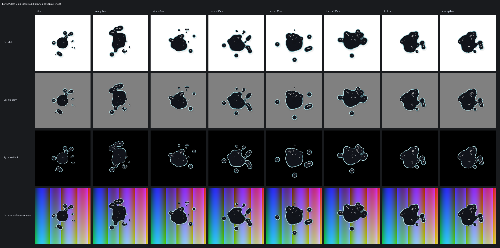

# FerroWidget

[]()
[]()
[]()

**FerroWidget** is a standalone Ubuntu desktop widget that renders a photorealistic, glossy black ferrofluid floating directly on the desktop with a **fully transparent background** (no window frame, no dome, no backdrop). It dances in real time to system audio output (`<default_sink>.monitor`) with ultra-low latency (<= 60 ms end-to-end).

Inspired by commercial physical ferrofluid display speakers, FerroWidget simulates magnetic fluid physics: merging puddles, stretching fluid necks, pinching off satellite droplets, and sprouting sharp hexagonal Rosensweig spikes on bass hits.

---

## Visual Previews

### Obsidian Liquid on Multiple Backgrounds


### Electric Neon Theme & Rainbow Oilslick
| Theme: Neon | Theme: Oilslick |
|:---:|:---:|
|  |  |

---

## Key Features

- **True Desktop Click-Through Transparency**: Renders directly on top of wallpapers, windows, and desktop icons via per-pixel alpha OpenGL (Core Profile 3.3) and native X11 `XShape` input masking.
- **Dual Operating Modes**:
  - **LOCKED Mode** (default): 100% click-through transparent desktop overlay.
  - **EDIT Mode**: Interactive dashed boundary; left-click drag to reposition, mouse wheel to resize (128px to 1200px), double-click or `Esc` to lock and persist geometry.
- **Real-Time System Audio Capture**: Captures whatever audio the desktop is playing (Spotify, YouTube, VLC, browser) from PipeWire / PulseAudio default sink monitor.
- **Studio HDR Shading**:
  - Analytic signed-distance anti-aliased silhouette.
  - 2.5D meniscus height-field with capillary micro-ripples.
  - Studio softboxes, strip rim lighting, and intense pinpoint specular glints.
  - Studio cyclorama floor bounce illuminating steep meniscus outer edges for 100% legibility on pure black wallpapers.
- **4 Visual Themes**:
  - `ink`: Deep obsidian black (`F0 = 0.065`), crisp white glints, cool-grey rim.
  - `mercury`: Liquid silver chrome (`F0 = 0.92`), brilliant specular reflections.
  - `oilslick`: Black base with vivid thin-film rainbow iridescence.
  - `neon`: Obsidian black with electric cyan / magenta rim glow.
- **Choreography & Underdamped Physics**:
  - 64 droplets (6 core puddles, 22 satellites, 36 mist droplets).
  - 19 electromagnets (center bass magnet, 6 inner-ring mid magnets, 12 outer-ring rotating spectrum magnets).
  - Pairwise soft cohesion and core repulsion.
  - 2nd-order underdamped spring ODEs for jelly-like radius overshoot and Rosensweig spike bounce.
- **Resource Footprint**:
  - Physics step time: **< 0.2 ms / frame** (vectorized via NumPy).
  - Hop DSP latency: **~0.23 ms** (budget <= 1.0 ms).
  - GPU render time: **~1.5 ms / frame** (budget <= 2.0 ms).
  - Zero heap churn in frame loops (preallocated arrays).

---

## Installation & Setup

### System Prerequisites
Ensure audio utilities and OpenGL libraries are installed on Ubuntu:
```bash
sudo apt update
sudo apt install -y pulseaudio-utils mesa-utils libxcb-cursor0 python3-venv
```

### Virtual Environment Setup
```bash
git clone https://github.com/asa/ferrowidget.git
cd ferrowidget
python3 -m venv .venv
source .venv/bin/activate
pip install -e .
```

---

## Usage

### Run Desktop Overlay
```bash
# Run with live system audio
ferrowidget run

# Run with deterministic synthetic test track
ferrowidget run --synthetic full_mix

# Run with safety exit timer (useful for scripts)
ferrowidget run --synthetic kick120 --exit-after 10
```

### Remote Control CLI (`ferrowidget ctl`)
Communicate with a running instance over `$XDG_RUNTIME_DIR/ferrowidget.sock`:
```bash
# Toggle interactive edit mode (move / resize)
ferrowidget ctl edit toggle

# Switch visual theme
ferrowidget ctl theme oilslick
ferrowidget ctl theme neon
ferrowidget ctl theme mercury
ferrowidget ctl theme ink

# Switch physics dynamics preset
ferrowidget ctl preset calm
ferrowidget ctl preset club
ferrowidget ctl preset cinematic

# Set size or move widget
ferrowidget ctl size 480
ferrowidget ctl move 1200 600

# Query runtime metrics (FPS, geometry, loudness, onsets)
ferrowidget ctl status

# Cleanly quit
ferrowidget ctl quit
```

### System Diagnostic (`ferrowidget doctor`)
```bash
ferrowidget doctor
```

### Headless Frame Dump & Contact Sheet
```bash
ferrowidget dump-frame --synthetic kick120 --out dumped_frames --contact-sheet
```

### Autostart on Desktop Login
```bash
ferrowidget install-autostart
```

---

## Configuration (`~/.config/ferrowidget/config.toml`)
The configuration file is auto-created with documentation comments and supports live hot-reloading:

```toml
[window]
x = -1                  # Top-left X (-1 for auto anchor)
y = -1                  # Top-left Y (-1 for auto anchor)
size = 420             # Square size in pixels (128 - 1200)
monitor = "primary"
layer = "top"           # "top", "normal", "bottom"
locked = true           # true = click-through desktop overlay
opacity = 1.0
anchor = "bottom-right" # "top-left", "top-right", "bottom-left", "bottom-right", "center"
margin = 40             # Margin from screen edges

[audio]
source = "auto"         # "auto" monitor sink or specific source
sensitivity = 1.0       # Sensitivity multiplier (0.1 - 10.0)
visual_delay_ms = 0     # Latency compensation delay (0 - 500 ms)
agc = true              # Adaptive Gain Control enabled

[fluid]
preset = "club"         # "calm", "club", "cinematic"
droplets = 64
viscosity = 1.0
magnet_gain = 1.0
kick_impulse = 1.0
spike_amount = 1.0
idle_breathing = true

[look]
theme = "ink"           # "ink", "mercury", "oilslick", "neon"
rim = 0.65
glints = 1.0
shadow = 0.22
iridescence = 0.0

[perf]
fps_cap = 60
idle_fps = 15
render_scale = 1.0
mode = "heightfield"    # "heightfield" or "raymarch"
```

---

## Running Tests & Linter
```bash
# Run pytest test suite (18 unit/integration tests)
pytest -v

# Run ruff linter
ruff check .
```

---

## Architecture

```
ferrowidget/
  ├── pyproject.toml
  ├── README.md
  ├── docs/DECISIONS.md
  ├── tests/
  │   ├── test_dsp.py          # Band accuracy, onset timing, AGC invariance, latency
  │   ├── test_physics.py      # Determinism, 10-minute energy bounds, zero NaNs
  │   ├── test_config.py       # Loading, validation, clamping, persistence
  │   ├── test_render.py       # Alpha bounds, premultiplied invariant, themes
  │   └── test_cli_ipc.py      # Unix socket JSON-line protocol roundtrip, doctor
  ├── packaging/
  │   ├── ferrowidget.desktop  # XDG desktop launcher with GNOME delay
  │   └── ferrowidget.service  # systemd user unit
  └── src/ferrowidget/
      ├── __init__.py
      ├── __main__.py
      ├── cli.py               # run, ctl, doctor, dump-frame, install-autostart
      ├── app.py               # QApplication, tray, lifecycle, signals, exit timer
      ├── config.py            # Typed dataclasses, TOML comments, hot-reload
      ├── window.py            # Transparent frameless GL window, locked/edit modes
      ├── x11.py               # EWMH & XShape input click-through masking
      ├── ipc.py               # Unix domain socket JSON-line server & client
      ├── audio/
      │   ├── capture.py       # parec / pw-record reader, sink change watcher
      │   ├── analysis.py      # STFT, 32 log bands, pink tilt, AGC, flux onsets
      │   └── synthetic.py     # kick120, bass_sweep, noise_bursts, full_mix, silence
      ├── physics/
      │   └── fluid.py         # 64 droplets, 19 magnets, 240Hz semi-implicit Euler
      └── render/
          ├── renderer.py      # ModernGL FBO pipeline, themes, contact sheets
          └── shaders/
              ├── ferro.vert   # Fullscreen quad vertex shader
              └── ferro.frag   # Metaballs, Rosensweig spikes, HDR studio lighting
```

---

## License
MIT License.
