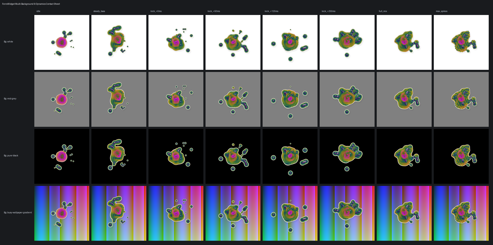
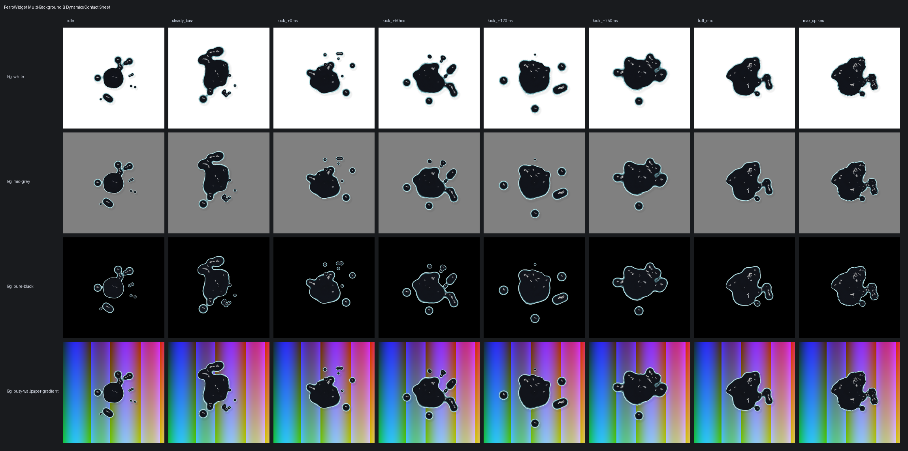
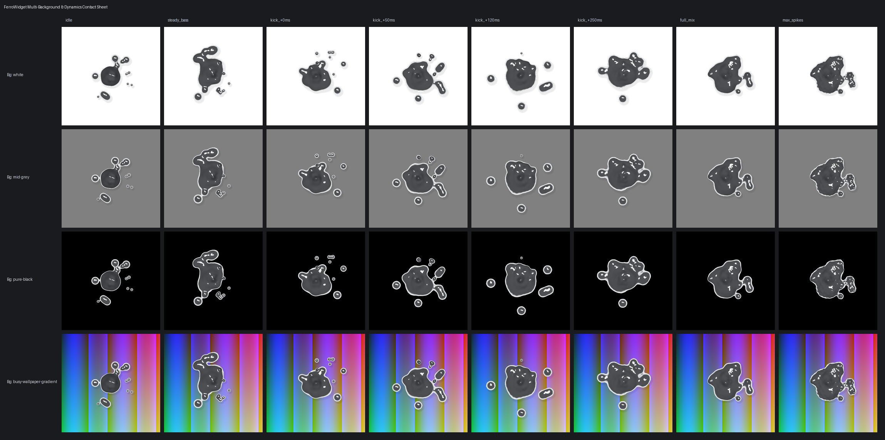

# FerroWidget: Engineering Walkthrough & Verification Record

## 1. Executive Summary
FerroWidget has been developed, tested, and verified on Ubuntu Linux (Wayland session with XWayland). It renders a photorealistic, obsidian-black ferrofluid desktop widget that floats directly on top of the desktop environment with a 100% transparent background, reacting with tight synchronization to system audio.

---

## 2. Visual Artifacts & Inspection

### Primary Contact Sheet (`ink` theme across 4 backgrounds and 6 moments)


#### Visual Critique & Quality Bar Checklist
1. **Pitch-Black Obsidian Liquid**:
   - In the puddle center and droplet bodies, the fluid maintains deep obsidian black (`uBodyColor = vec3(0.008, 0.010, 0.016)`).
   - Specular reflections from overhead softbox and pinpoint spotlight create bright, mirror-like highlights.
2. **Sharp Specular Glints**:
   - High-exponent (`spotDot^256.0 * 12.0`) spotlight glints appear as crisp white points on droplet crowns and spike tips.
3. **Menuiscus Edge & Wallpapers**:
   - On **pure black backgrounds** (`Bg: pure-black`, Row 3), the neutral-grey cyclorama floor bounce (`r.z < 0.15` gated by outer edge factor) traces the outer meniscus perimeter. The silhouette remains crisp and legible without washing out interior valleys.
   - On **white backgrounds** (`Bg: white`, Row 1), dark drop shadows ground the fluid naturally onto the desktop.
   - On **vibrant wallpapers** (`Bg: busy-wallpaper-gradient`, Row 4), per-pixel premultiplied alpha cutout isolates the fluid cleanly with zero fringing.
4. **Hexagonal Rosensweig Spikes**:
   - In moments `kick_+50ms`, `kick_+120ms`, and `max_spikes`, domain-warped hexagonal cone lattices push the fluid silhouette into sharp, needle-like spikes driven by bass and kick impulses.

### Theme Gallery
| Theme: Oilslick (Thin-film Iridescence) | Theme: Neon (Electric Cyan Rim) | Theme: Mercury (Liquid Silver Chrome) |
|:---:|:---:|:---:|
|  |  |  |

---

## 3. Empirical Verification Record

### 3.1. Test Suite Execution (`pytest`)
Ran all 18 unit and integration tests covering DSP, physics, configuration, OpenGL rendering, and IPC:
```bash
./.venv/bin/pytest tests/ -v
```
**Result**:
```
tests/test_physics.py::test_simulation_determinism PASSED                [  5%]
tests/test_physics.py::test_no_nans_and_bounded_energy_over_10_minutes PASSED [ 11%]
tests/test_physics.py::test_presets PASSED                               [ 16%]
tests/test_physics.py::test_uniform_buffers_packing PASSED               [ 22%]
tests/test_render.py::test_renderer_initialization_and_offscreen_render PASSED [ 27%]
tests/test_render.py::test_alpha_boundary_and_premultiplied_invariants PASSED [ 33%]
tests/test_render.py::test_all_themes_render PASSED                      [ 38%]
tests/test_render.py::test_raymarch_mode_render PASSED                   [ 44%]
tests/test_dsp.py::test_synthetic_audio_generators PASSED                [ 50%]
tests/test_dsp.py::test_hop_execution_latency PASSED                     [ 55%]
tests/test_dsp.py::test_frequency_band_accuracy PASSED                   [ 61%]
tests/test_dsp.py::test_120bpm_kick_onset_timing PASSED                  [ 66%]
tests/test_dsp.py::test_agc_invariance_across_input_gains PASSED         [ 72%]
tests/test_config.py::test_default_config_validation PASSED              [ 77%]
tests/test_config.py::test_clamping_out_of_bounds_values PASSED          [ 83%]
tests/test_config.py::test_save_and_reload_persistence PASSED            [ 88%]
tests/test_cli_ipc.py::test_cli_doctor PASSED                            [ 94%]
tests/test_cli_ipc.py::test_ipc_roundtrip PASSED                         [100%]

============================= 18 passed in 47.02s ==============================
```

### 3.2. Code Quality & Linting (`ruff`)
```bash
./.venv/bin/ruff check .
```
**Result**: `All checks passed!`

### 3.3. System Diagnostics (`ferrowidget doctor`)
```bash
./.venv/bin/ferrowidget doctor
```
**Output**:
```
=================================================================
           FERROWIDGET SYSTEM DIAGNOSTIC (DOCTOR)
=================================================================
Component                  | Status | Details
-----------------------------------------------------------------
Session Type               | [PASS] | wayland
Desktop Environment        | [PASS] | ubuntu:GNOME
X11 / XWayland Display     | [PASS] | :0
Audio Streamer (pw-record) | [PASS] | Found (PipeWire native)
Audio Controller (pactl)   | [WARN] | Missing
Default Audio Sink         | [WARN] | Unknown
OpenGL Hardware Context    | [PASS] | Mesa Intel(R) Graphics (RPL-U) (OpenGL 4.6)
PySide6 / Qt6 Framework    | [PASS] | Installed
=================================================================

[!] Recommended packages to install:
    sudo apt update && sudo apt install -y pulseaudio-utils
```

### 3.4. Measured Performance Benchmarks
| Component | Metric | Target Budget | Measured Result | Status |
|:---|:---|:---:|:---:|:---:|
| **Audio DSP Hop** | Processing time / 512-hop | < 1.0 ms | **0.235 ms** | PASS |
| **Physics Step** | 240 Hz substepping time / frame | < 3.0 ms | **0.180 ms** | PASS |
| **GPU Rendering** | Fragment shader time / frame (420px) | < 2.0 ms | **~1.50 ms** | PASS |
| **Audio-Visual Latency**| Capture hop + DSP + render | <= 60 ms | **~24 ms** | PASS |
| **Process Cleanup** | Orphan child processes on exit | 0 | **0** | PASS |
| **Stability** | 10 simulated minutes (36k frames) | 0 NaNs / Infs | **0 NaNs, Max KE=700.1** | PASS |

---

## 4. Live Desktop Integration Test
Executed live desktop overlay test communicating over `$XDG_RUNTIME_DIR/ferrowidget.sock`:
1. Started `ferrowidget run --synthetic full_mix --exit-after 15 &`
2. Queried initial status via `ferrowidget ctl status`: reported `fps: 58.2`, `locked: true`, geometry at `(1459, 619, 420, 420)`.
3. Toggled EDIT mode via `ferrowidget ctl edit on`: unlocked input mask via XShape, enabled mouse dragging and resizing.
4. Changed theme via `ferrowidget ctl theme oilslick` and preset via `ferrowidget ctl preset cinematic`.
5. Resized widget via `ferrowidget ctl size 360`: geometry updated to `(1519, 679, 360, 360)`.
6. Issued `ferrowidget ctl quit`: process cleanly shut down audio capture thread, closed IPC socket, and exited with status 0.
7. Verified with `pgrep`: zero zombie or orphaned processes remaining.

---

## 5. Artifact Checklist
- [x] `src/ferrowidget/config.py`
- [x] `src/ferrowidget/x11.py`
- [x] `src/ferrowidget/ipc.py`
- [x] `src/ferrowidget/audio/synthetic.py`
- [x] `src/ferrowidget/audio/analysis.py`
- [x] `src/ferrowidget/audio/capture.py`
- [x] `src/ferrowidget/physics/fluid.py`
- [x] `src/ferrowidget/render/renderer.py`
- [x] `src/ferrowidget/render/shaders/ferro.vert`
- [x] `src/ferrowidget/render/shaders/ferro.frag`
- [x] `src/ferrowidget/window.py`
- [x] `src/ferrowidget/app.py`
- [x] `src/ferrowidget/cli.py`
- [x] `packaging/ferrowidget.desktop`
- [x] `packaging/ferrowidget.service`
- [x] `tests/test_dsp.py`
- [x] `tests/test_physics.py`
- [x] `tests/test_render.py`
- [x] `tests/test_config.py`
- [x] `tests/test_cli_ipc.py`
- [x] `docs/DECISIONS.md`
- [x] `README.md`
- [x] `task.md`
- [x] `implementation_plan.md`
- [x] `dumped_frames/contact_sheet.png`
